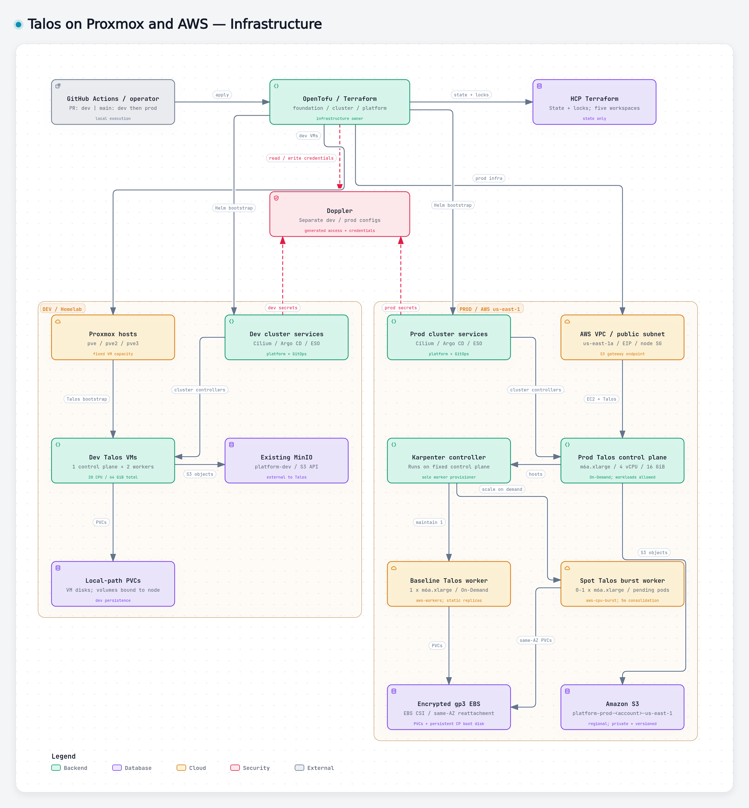

# Talos on Proxmox and GCP

Two independent Kubernetes environments run Talos: **dev** on the existing Proxmox hosts and **prod** on Google Compute Engine. OpenTofu provisions infrastructure, each cluster's Argo CD manages applications, and Doppler supplies credentials.

Dev keeps the existing Proxmox VM allocations with one control-plane/workload node and two workers. It has no cloud workers or node autoscaler. Prod uses one fixed `e2-standard-4` control-plane/workload VM and a Cluster Autoscaler-managed baseline of three `e2-standard-4` workers, fixed at three. A separate Spot group scales from zero to twelve workers. Production CPU VMs each have 4 vCPU and 16 GiB RAM. Both environments retain Kubernetes `v1.37.2`; production uses Cluster Autoscaler `v1.37.0` pinned by image digest. Each has a single control plane and single-instance PostgreSQL; neither is highly available.

Dev uses local-path and existing MinIO. Prod uses expandable GCE Persistent Disk storage and one private GCS object bucket with purpose prefixes, accessed through the S3-compatible XML API with HMAC credentials. GCP production can enable one fixed on-demand L4 worker through `gcp_gpu_enabled` (currently off); production local-model caching remains disabled. State, application credentials and public domains remain independent.

## Start here

| I want to…                                                | Read                                                               |
| --------------------------------------------------------- | ------------------------------------------------------------------ |
| Contribute, validate, or deploy                           | [Contributing and setup](CONTRIBUTING.md)                          |
| Understand provisioning, state, and CI                    | [Terraform and CI architecture](docs/architecture/terraform-ci.md) |
| Understand GCP networking and autoscaling                 | [GCP worker architecture](docs/architecture/gcp-workers.md)        |
| Understand application ownership and reconciliation       | [GitOps and Argo CD architecture](docs/architecture/gitops.md)     |
| Connect to a cluster or check its health                  | [Cluster access](docs/operations/cluster-access.md)                |
| Schedule cloud workloads or rotate controller credentials | [GCP worker operations](docs/operations/gcp-workers.md)            |
| Find a credential's source and consumers                  | [Secrets reference](docs/reference/secrets.md)                     |

## Repository map

| Path                                                                              | Contents                                                                         |
| --------------------------------------------------------------------------------- | -------------------------------------------------------------------------------- |
| [`terraform/foundation/`](terraform/foundation/)                                  | Operator-applied identities, Doppler tokens, GitHub Environments, HCP workspaces |
| [`terraform/cluster/`](terraform/cluster/)                                        | Separate dev/prod infrastructure entrypoints and environment inventory           |
| [`terraform/platform/`](terraform/platform/)                                      | Per-environment CNI, Gateway API CRDs, ESO authentication, Argo CD bootstrap     |
| [`terraform/proxmox/`](terraform/proxmox/) and [`terraform/gcp/`](terraform/gcp/) | Modules called by the cluster root                                               |
| [`apps/argocd/`](apps/argocd/)                                                    | Bootstrap and shared platform Application charts                                 |
| [`apps/components/`](apps/components/)                                            | Component charts, vendored dependencies, environment overrides                   |
| [`.github/workflows/`](.github/workflows/)                                        | Validation and provisioning workflows                                            |
| [`openspec/`](openspec/)                                                          | Behavior specifications and archived change records                              |

Use `devenv shell` for the project's OpenTofu, Helm, Doppler, Talos, and Kubernetes tools. The [deployment guide](CONTRIBUTING.md) explains the account access and external services required before applying anything.
