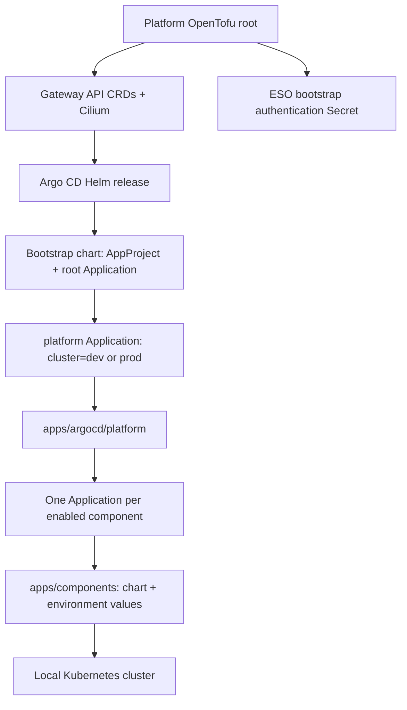
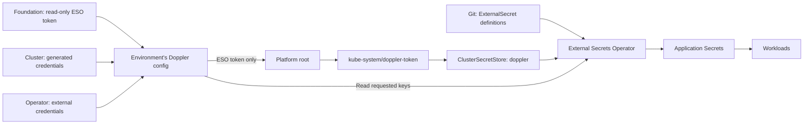

# GitOps and Argo CD architecture

[Documentation home](../../README.md) · [Cluster access](../operations/cluster-access.md)

Each environment runs its own Argo CD in namespace `argo-cd`. Both read the same public Git repository and shared platform chart, but each renders only its own components and targets its local Kubernetes API.

## Bootstrap and reconciliation



The [bootstrap chart](../../apps/argocd/bootstrap/) creates the `talos-proxmox` AppProject and the `platform` root Application. The [platform chart](../../apps/argocd/platform/) creates child Applications from its component table. Every destination is `https://kubernetes.default.svc`; there are no remote-cluster registrations or cross-environment kubeconfigs.

## One owner per resource

| Owner | Components |
| --- | --- |
| Platform OpenTofu root | Gateway API CRDs, Cilium, Talos CCM, ESO token namespace/Secret, Karpenter (CRDs, controller, `EC2NodeClass`, `NodePool`, and its AWS key Secret), Argo CD and bootstrap AppProject/root Application |
| Argo CD | ESO/store, storage, metrics, GPU components, Istio, operators, observability and its telemetry agents, Cloudflare operator/CRDs and `ClusterTunnel` |

Cilium and Argo CD remain OpenTofu-owned after bring-up. Changes to them go through a platform apply. Application changes go through Git and Argo CD.

An environment destroy removes the cluster and empties the platform root's state; it does not uninstall anything from the cluster. The platform root and Argo CD components must therefore not create external resources requiring removal on destroy, such as tailnet devices or unmanaged cloud resources. The cluster or foundation root owns the removal of external infrastructure, as the cluster root does for Karpenter's EC2 instances and launch templates. Existing Cloudflare tunnels may outlive destroys; see [public hostnames](#public-hostnames).

The platform root installs Talos CCM before Argo CD so AWS cloud-node initialization does not depend on GitOps. Argo CD creates shared namespaces and installs its own OIDC Secret and public tunnel route through the `argocd-post` Application after the secret-store and Cloudflare CRDs are available. The initial OpenTofu-owned Argo CD chart does not depend on those CRDs. The `argocd-post` chart also owns shared namespace declarations; Kubeflow owns its `ml-s3` training credential ExternalSecret.

## Membership, overlays, and ordering

The source of truth is [`apps/argocd/platform/values.yaml`](../../apps/argocd/platform/values.yaml). Each component declares its `clusters`, destination namespace, source path, and sync wave. Helm is the default source and requires a release name; `valueFilesByCluster` selects optional environment overrides. Set `sourceType: kustomize` for a Git-owned Kustomization path instead of a Helm chart.

| Wave | Components | Environments |
| --- | --- | --- |
| -4 | Argo CD post-install resources and shared namespaces | dev, prod |
| -3 | External Secrets Operator and Doppler ClusterSecretStore | dev, prod |
| -2 | Istio ambient (base, istiod, CNI, ztunnel, ingress gateway) | dev, prod |
| -1 | Metrics-server and shared Argo Workflows with the environment's data-workflow lifecycle guard | dev, prod |
| 0 | local-path (dev) or EBS CSI (prod), auth, Spark operator, cert-manager, CNPG, Strimzi, Redis operator | dev, prod |
| 1 | GPU operator, NVIDIA DRA | dev, prod |
| 1 | Flink operator, Iceberg catalog, StarRocks, Knative and observability | dev, prod |
| 2 | Kubeflow and ML storage credentials, Cloudflare operator and tunnel | dev, prod |
| 3 | OpenMetadata | dev, prod |

Both environments run independent telemetry components and have no dependency on each other.

Waves order submission of child Applications; they do not wait for each child's resources to become healthy. Children converge asynchronously. Unlimited retries with backoff and `SkipDryRunOnMissingResource` handle dependencies such as CRDs arriving later. Automated prune removes resources deleted from Git, and self-heal repairs drift.

Argo CD uses server-side apply and server-side diff. Privileged component namespaces get labels through `managedNamespaceMetadata`. Cilium runs in `kube-system`; Istio runs in privileged `istio-system`.

The `flink-operator` component pins Apache Flink Kubernetes Operator 1.16.1, with namespace-scoped controller RBAC and cert-manager webhook certificates. The fraud application owns Flink jobs and their service accounts/RBAC, plus the Feast server, ordered writer and dedicated Redis. Installing the controller does not start those workloads. The application chart owns checkpoint/savepoint/HA paths, checkpoint scheduling, the MinIO endpoint and credential references. Jobs must include the matching Flink S3 filesystem plugin. Flink creates job-ID subdirectories; replay must use a separate job and must not restore live state.

Before starting jobs, a storage administrator must create the dedicated `fraud-flink-prod` bucket and user on the existing MinIO-compatible service, attach the [bucket-scoped policy](../../apps/components/flink-operator/storage-policy.json), and store that user's keys in Doppler `payment-gateway-fraud-detection/prd` as `FLINK_S3_ACCESS_KEY_ID` and `FLINK_S3_SECRET_ACCESS_KEY`. The application-owned ExternalSecret delivers them to `data/fraud-flink-storage`; the job injects them into JobManager/TaskManager environment variables, without credential files or credential PVCs. Restart jobs after rotation. Do not reuse Kubeflow credentials or apply age-based object expiration: retained incremental checkpoints/savepoints may still reference older objects. Bucket/user provisioning and restore acceptance remain pending.

## Secret delivery



The token Secret and Karpenter's `karpenter-aws` Secret are the Doppler-derived Kubernetes Secrets owned by OpenTofu. ESO owns the application Secrets, including the Cloudflare credentials Secret. Each store uses a read-only token scoped to its environment. Secret values never belong in Helm values files.

Application Secrets refresh hourly. Workloads that read credentials only at startup need an Argo CD Restart after the Secret refreshes. See [secret delivery and rotation](../reference/secrets.md#delivery-and-rotation).

## Public hostnames

Each environment has one Cloudflare tunnel, created once outside the cluster and named after it (`dev-talos`, `prod-talos`). The [`cloudflare-tunnel`](../../apps/components/cloudflare-tunnel/) chart installs the [Cloudflare operator](https://github.com/adyanth/cloudflare-operator) and a `ClusterTunnel` named `talos-proxmox` that runs that tunnel (`existingTunnel`) with the operator and a `cloudflared` Deployment in `operators`. The operator manifests and CRDs are vendored together from upstream kustomize output, since upstream ships no Helm chart. Never add public hostnames or other configuration to these tunnels in the Cloudflare dashboard: Cloudflare pushes dashboard configuration to `cloudflared`, replacing the ingress rules the operator writes.

Argo CD uses ClusterIP Services in both environments, published through the environment tunnel at `argocd-dev.phuchoang.sbs` or `argocd.phuchoang.sbs`. Grafana follows the same pattern. No LAN LoadBalancer Services, address pools or L2 announcements are provisioned.

A `TunnelBinding` lives in its origin Service's namespace, and the component that owns the routing also owns its binding. The platform publishes three prod hostnames of its own:

| Hostname | Origin | Owning component |
| --- | --- | --- |
| `auth.phuchoang.sbs` | `dex.auth:5556` | `auth` |
| `kubeflow.phuchoang.sbs` | `istio-ingressgateway.istio-system:80` | `kubeflow` (rendered into `istio-system`) |
| `grafana.phuchoang.sbs` | `grafana.observability:80` | `observability` |

Application repositories publish their own hostnames by rendering bindings next to their origin Services, such as `shop` and `pay` from the ecommerce repository. For each subject, the operator adds an ingress rule to the tunnel's configuration, restarts `cloudflared`, and creates a proxied CNAME plus a `_managed.<hostname>` TXT ownership record in the `phuchoang.sbs` zone. Deleting the binding removes both records. A subject's `target` defaults to the Service's first port, so set it explicitly. Bindings in components that sync before `cloudflare-tunnel` retry until its CRDs exist.

```yaml
apiVersion: networking.cfargotunnel.com/v1alpha1
kind: TunnelBinding
metadata:
  name: web
  namespace: example
subjects:
  - kind: Service
    name: web
    spec:
      fqdn: web.phuchoang.sbs
      target: http://web.example.svc.cluster.local:80
tunnelRef:
  kind: ClusterTunnel
  name: talos-proxmox
```

The operator refuses a hostname whose existing record has no ownership TXT record, or whose TXT record belongs to another tunnel. Delete such records in Cloudflare before binding the hostname. Because dev and prod share the zone, each environment can only claim hostnames that the other does not own.

An environment destroy leaves the tunnel and its DNS records in Cloudflare. The rebuilt environment runs the same tunnel, so the operator recognizes its ownership records and takes the hostnames back without changes.

## Change a component

1. Edit its chart or values under [`apps/components/`](../../apps/components/). Keep vendored dependencies and `Chart.lock` consistent when changing a dependency.
2. For environment-specific settings, add or edit an overlay and reference it in `valueFilesByCluster`. To add/remove an environment, edit the component's `clusters` list.
3. Lint/render the chart locally, then submit the Git change. CI validates the component charts and dev/prod platform definitions.
4. After merging to `main`, check that environment's Application for Synced/Healthy status.

Removing an environment from `clusters` removes its child Application; the child Application's resource finalizer performs cascading cleanup. Inspect what it owns before removing a storage component.

To inspect rendered membership without connecting to a cluster:

```bash
helm template platform apps/argocd/platform \
  --namespace argo-cd --set cluster=dev --kube-version 1.37.2
```

For deployment status and UI addresses, use [cluster access](../operations/cluster-access.md).

Both environments use `data` for Iceberg, OpenMetadata, StarRocks and Spark/Flink jobs, `ml` for Kubeflow/KServe and ML workloads, and `operators` for shared controllers, Argo Workflows and storage provisioners. Knative Serving/Eventing and Istio retain their upstream namespaces; auth, Argo CD, observability and Kubernetes system namespaces remain separate. Downstream applications create Spark/Flink jobs and their credentials in the platform-owned `data` namespace; both operators watch `data`.
