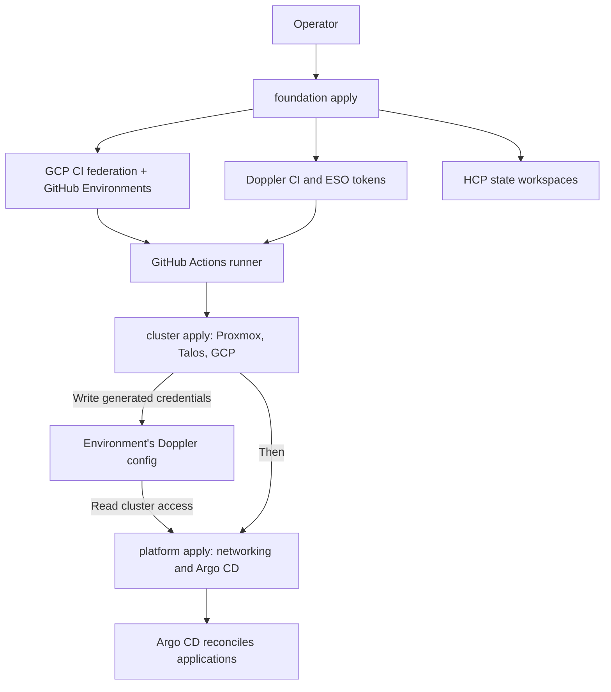
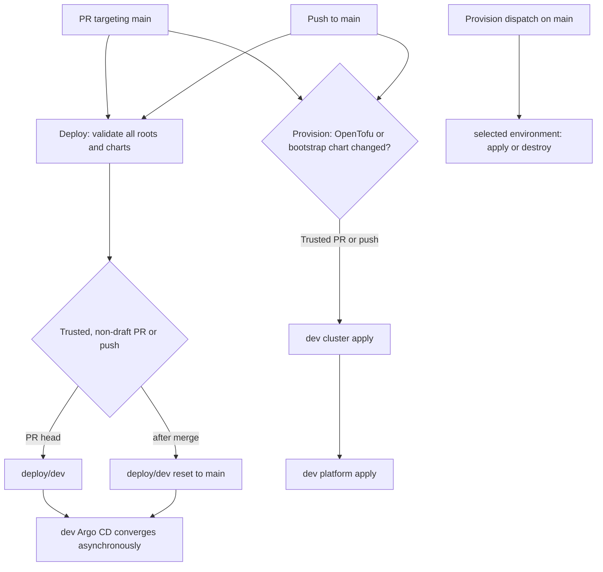

# Terraform and CI architecture

[Documentation home](../../README.md) · [Deploy the platform](../../CONTRIBUTING.md)

The repository uses Terraform configuration executed by **OpenTofu**. Three layers divide account setup, cluster infrastructure, and the components needed to start GitOps. They use five active states: one foundation state plus separate cluster and platform states for dev and prod; generated credentials move between roots through Doppler.

## Roots and ownership

| Root | Applied by | Owns | HCP workspace |
| --- | --- | --- | --- |
| `foundation` | Operator | Selected cloud CI identity and object storage, Doppler project/environments and service tokens, GitHub Environments, four state workspaces | `talos-proxmox` |
| `cluster/dev`, `cluster/prod` | CI/operator, per environment | Proxmox dev or selected GCP/AWS prod, independent Talos identity/configuration and generated credentials | `talos-cluster-dev`, `talos-cluster-prod` |
| `platform` | CI, per environment | Gateway API CRDs, Cilium, ESO bootstrap token Secret, Argo CD with its root Application and tunnel routes | `talos-platform-dev`, `talos-platform-prod` |

`terraform/proxmox`, `terraform/gcp` and `terraform/aws` are modules called by `cluster`, not separate deployment roots. `terraform/aws` is the alternative production cluster module, with account resources in `terraform/aws/foundation`, mirroring `terraform/gcp/foundation`. Foundation and cluster roots select one cloud with `cloud_provider`, defaulting to `gcp`; AWS needs no extra state. Cluster roots bootstrap Talos and Kubernetes; the platform root installs Kubernetes components. Argo CD owns the remaining cluster components; see [GitOps architecture](gitops.md).

The separate platform root makes Kubernetes and Helm provider credentials available before its plan starts. It reads the kubeconfig from Doppler. No root reads another root's remote state.

## Workflow flow

Lint runs on every PR and push, fork PRs included, so a later dispatch does not start from broken charts. Trusted repository PRs and `main` apply dev when OpenTofu or a chart it installs changes; fork PRs get no deployment. Prod is provisioned only by dispatch on `main`; there is no prod plan on PRs. Argo CD tracks a branch, not a commit: dev follows `deploy/dev` and prod follows `main`, so platform changes under `apps/` reach dev without a Provision run.

| Workflow | Responsibility |
| --- | --- |
| [`deploy.yml`](../../.github/workflows/deploy.yml) | Lint every PR and push; publish `deploy/dev` from trusted, non-draft, non-Renovate PRs and reset it to `main` after a merge |
| [`lint.yml`](../../.github/workflows/lint.yml) | Backend-disabled init, format and validate all roots; lint charts and environment overlays |
| [`provision.yml`](../../.github/workflows/provision.yml) | Apply the cluster and platform roots. Runs on trusted PRs and `main` when `terraform/cluster`, `terraform/platform`, `terraform/modules` or the charts the platform root installs change, and by manual dispatch on `main` to apply or destroy dev or prod |

Provisioning runs are serialized per environment and do not cancel an active run. The job timeout is 90 minutes. Destroy runs only the cluster root, which also removes GCE managed instance groups and their workers, and then empties the platform root's state instead of destroying it, so it does not need the Kubernetes API. Foundation is only validated by CI and must be applied locally.

## Credentials and network access

Each job gets its environment's `DOPPLER_TOKEN` from GitHub. Prod uses GitHub Workload Identity Federation for GCP and adds its current public egress /32 to stable operator management CIDRs. Dev reads Tailscale credentials and joins the tailnet, with no cloud identity or workers. Both read HCP credentials from Doppler with masked exports. Prod does not need Proxmox credentials.

| Access | Credential/path |
| --- | --- |
| GCP provisioning | Short-lived GitHub OIDC federation; application-default credentials from `google-github-actions/auth` |
| HCP state | `HCP_TERRAFORM_TOKEN`, exported as `TF_TOKEN_app_terraform_io` |
| Doppler | Environment-scoped read/write CI service token |
| Proxmox | `PROXMOX_*` read by the Doppler provider |
| Platform Kubernetes access | Generated `KUBECONFIG` read from Doppler |
| Private API routing | Tailscale runner identity `tag:ci` |

GitHub Environment policies allow main and PR merge refs for dev and only main for prod; workflow guards exclude fork PRs. GCP federation requires the immutable owner/repository IDs, the prod environment and `refs/heads/main`. Static PR validation does not use deployment secrets or remote state. Saved plans remain on the runner. See the [secrets reference](../reference/secrets.md) for ownership and consumers.

## State and environment isolation

All five HCP workspaces use local execution: HCP stores, versions, and locks state while OpenTofu runs on the operator's machine or CI runner. Platform roots select tagged workspaces and each cluster entrypoint pins its matching workspace through `TF_WORKSPACE`; validation checks that the selected workspace matches `env`.

The configured HCP operator token is shared across environments and can access their state. Workspace guards prevent accidental environment mismatch; they are not separate HCP authorization boundaries. State contains Talos identities, service tokens, and GCP controller keys, so access to it also grants access to those credentials.

## What a successful apply means

The platform first probes the API's authenticated `/readyz` endpoint, installs Gateway API CRDs, and waits for Cilium's rollout. Talos CCM follows Cilium, then Argo CD and production Cluster Autoscaler. Dev has no node autoscaler. The platform does not enumerate nodes or run Talos, etcd, or Kubernetes node health checks.

Cilium does not install SPIRE, LAN address pools or L2 announcements. Argo CD uses a ClusterIP Service in both environments, with Cloudflare access and management port-forward. Its Helm release waits for its own resources and can fail if they cannot become ready. CI finishes after the root Application is installed, without waiting for every child Application or tunnel.

A successful apply confirms installation of platform resources, not the health of every node. Node health and application convergence are operational checks; use the [convergence checks](../operations/cluster-access.md#check-convergence) afterward. A stale NotReady burst node does not independently block a platform apply.

Implementation: [`readiness.tf`](../../terraform/platform/readiness.tf), [`network.tf`](../../terraform/platform/network.tf), [`argocd.tf`](../../terraform/platform/argocd.tf).
