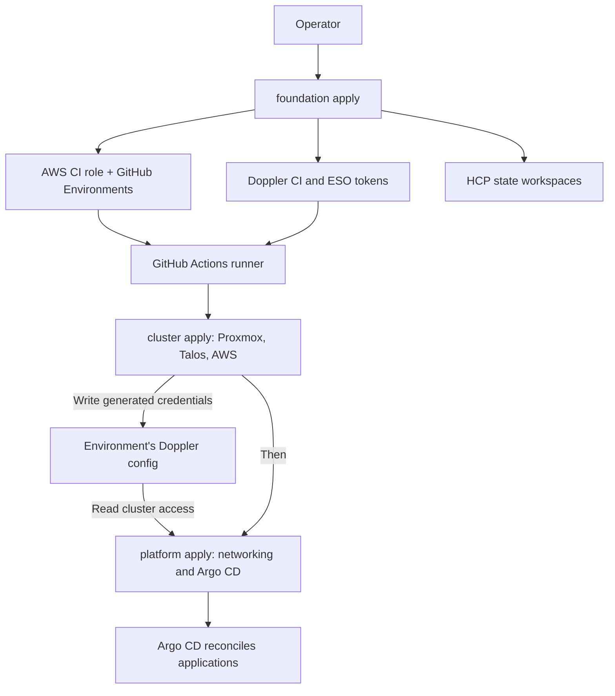
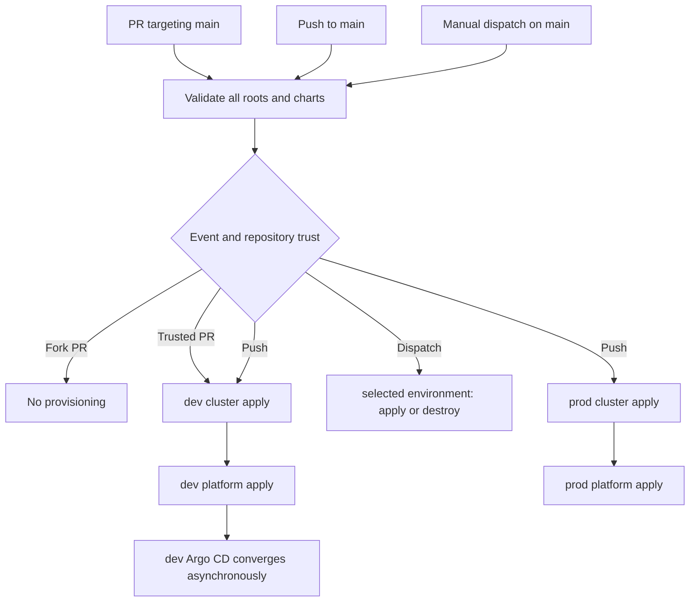

# Terraform and CI architecture

[Documentation home](../../README.md) · [Deploy the platform](../../CONTRIBUTING.md)

The repository uses Terraform configuration executed by **OpenTofu**. Three roots divide account setup, cluster infrastructure, and the components needed to start GitOps. Each root has its own state; generated credentials move between roots through Doppler.

## Roots and ownership

| Root | Applied by | Owns | HCP workspace |
| --- | --- | --- | --- |
| `foundation` | Operator | AWS CI identity, Doppler project/environments and service tokens, GitHub Environments, four state workspaces | `talos-proxmox` |
| `cluster/dev`, `cluster/prod` | CI/operator, per environment | Proxmox dev or AWS prod, independent Talos identity/configuration and generated credentials | `talos-cluster-dev`, `talos-cluster-prod` |
| `platform` | CI, per environment | Gateway API CRDs, Cilium, ESO bootstrap token Secret, Argo CD with its root Application and tunnel routes | `talos-platform-dev`, `talos-platform-prod` |

`terraform/proxmox` and `terraform/aws` are modules called by `cluster`, not separate deployment roots. Argo CD owns the remaining cluster components; see [GitOps architecture](gitops.md).

The separate platform root makes Kubernetes and Helm provider credentials available before its plan starts. It reads the kubeconfig from Doppler. No root reads another root's remote state.

## Workflow flow

Trusted repository PRs deploy dev; fork PRs validate only. Main updates dev and prod independently after lint succeeds. Manual applies can select a full main commit SHA; all Argo Applications are pinned to the selected SHA. Lint still renders dev's overlays on every PR, so a later dispatch does not start from broken charts.

| Workflow | Responsibility |
| --- | --- |
| [`terraform.yml`](../../.github/workflows/terraform.yml) | Runs only when `terraform/`, `apps/`, or `.github/workflows/` change: PR checks, and trusted PRs deploy dev; main deploys dev and prod independently |
| [`lint.yml`](../../.github/workflows/lint.yml) | Backend-disabled init, format and validate all roots; lint charts and environment overlays |
| [`provision.yml`](../../.github/workflows/provision.yml) | Reusable per-environment apply or destroy, restricted to `main` pushes/manual dispatches and trusted PRs targeting dev |
| [`manual.yml`](../../.github/workflows/manual.yml) | Validate, then apply or destroy one selected environment on `main` |

Provisioning runs are serialized per environment and do not cancel an active run. The job timeout is 90 minutes. Destroy runs only the cluster root, which also removes Karpenter's EC2 instances and launch templates, and then empties the platform root's state instead of destroying it, so it does not need the Kubernetes API. Foundation is only validated by CI and must be applied locally.

## Credentials and network access

Each job gets its environment's `DOPPLER_TOKEN` from GitHub. Both jobs use GitHub OIDC for their AWS resources. Prod adds its current public egress /32 to stable operator management CIDRs. Dev reads Tailscale credentials and joins the tailnet. Both read HCP credentials from Doppler with masked exports. Prod does not need Proxmox credentials; dev also uses AWS for its independent burst workers.

| Access | Credential/path |
| --- | --- |
| AWS provisioning | Short-lived GitHub OIDC session; ambient AWS provider credentials |
| HCP state | `HCP_TERRAFORM_TOKEN`, exported as `TF_TOKEN_app_terraform_io` |
| Doppler | Environment-scoped read/write CI service token |
| Proxmox | `PROXMOX_*` read by the Doppler provider |
| Platform Kubernetes access | Generated `KUBECONFIG` read from Doppler |
| Private API routing | Tailscale runner identity `tag:ci` |

GitHub Environment policies allow main and PR merge refs for dev, and only main for prod; AWS trust is limited to the dev/prod environment subjects. PR validation does not use deployment secrets or remote state. Saved plans remain on the runner. See the [secrets reference](../reference/secrets.md) for ownership and consumers.

## State and environment isolation

All five HCP workspaces use local execution: HCP stores, versions, and locks state while OpenTofu runs on the operator's machine or CI runner. Platform roots select tagged workspaces and each cluster entrypoint pins its matching workspace through `TF_WORKSPACE`; validation checks that the selected workspace matches `env`.

The configured HCP operator token is shared across environments and can access their state. Workspace guards prevent accidental environment mismatch; they are not separate HCP authorization boundaries. State contains Talos identities, service tokens, and AWS keys, so access to it also grants access to those credentials.

## What a successful apply means

The platform first probes the API's authenticated `/readyz` endpoint, installs Gateway API CRDs, and waits for Cilium's rollout. Talos CCM follows Cilium, then Argo CD and each environment’s Karpenter controller. The platform does not enumerate nodes or run Talos, etcd, or Kubernetes node health checks.

Cilium does not install SPIRE, LAN address pools or L2 announcements. Argo CD uses a ClusterIP Service in both environments, with Cloudflare access and management port-forward. Its Helm release waits for its own resources and can fail if they cannot become ready. CI finishes after the root Application is installed, without waiting for every child Application or tunnel.

A successful apply confirms installation of platform resources, not the health of every node. Node health and application convergence are operational checks; use the [convergence checks](../operations/cluster-access.md#check-convergence) afterward. A stale NotReady burst node does not independently block a platform apply.

Implementation: [`readiness.tf`](../../terraform/platform/readiness.tf), [`network.tf`](../../terraform/platform/network.tf), [`argocd.tf`](../../terraform/platform/argocd.tf).
